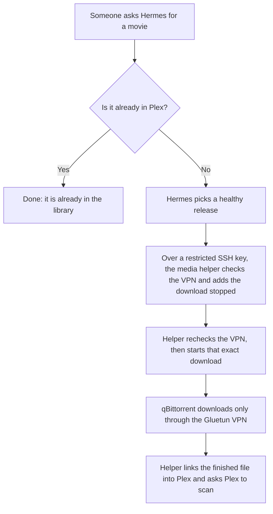

# Hermes media workflow



A systemd service on the media host starts the VPN and download containers once storage is mounted, and restarts them if either one stops.

## How ours runs

| Piece | Where | What it does |
| --- | --- | --- |
| Hermes + `media.py` client | Hermes VM | The `plex-torrent` skill calls [`media.py`](reference/deployment/agent/plex-backend/scripts/media.py), which sends one JSON request over SSH with a dedicated key and a pinned host key. |
| [`media_backend.py`](reference/deployment/media-host/media_backend.py) | Media host, SSH forced command | `authorized_keys` ties the VM key to `restrict,command="/usr/bin/python3 /opt/agent-media/media_backend.py"`. It accepts only `status`, `libraries`, `search`, `scan`, `torrents`, `files`, `add`, `start`, `stop` and `import`. `add` and `start` refuse unless Gluetun is healthy, qBittorrent is bound to `tun0` in Gluetun's network namespace and the VPN acceptance record matches. `import` hardlinks a completed file into a Plex section; `scan` asks Plex to refresh it. |
| [`agent-media.service`](reference/deployment/media-host/agent-media.service) | Media host, systemd | Checks the storage mounts, VPN credentials and Compose file, then supervises `docker compose up` for Gluetun and qBittorrent. It restarts the pair 15 seconds after either exits. |
| Gluetun + qBittorrent | Media host, Docker | qBittorrent shares Gluetun's network namespace. The Web UI is published on host loopback only. If the tunnel drops, Gluetun's firewall blocks direct traffic. |
| Plex | Media host | Scans its own libraries. Downloads and library share one filesystem so imports are hardlinks. |

## Install the skills in an existing Hermes

From the root of this repository, as the account that runs Hermes:

```sh
skills="${HERMES_HOME:-$HOME/.hermes}/skills"
mkdir -p "$skills"
cp -R agent/skills/plex-torrent agent/skills/game-search host/skills/plex-directory-setup "$skills/"
```

Start a new chat afterwards. If one of these skills already exists, compare the files before replacing local edits.

- [`agent/skills/plex-torrent`](agent/skills/plex-torrent/SKILL.md): check Plex, choose a release, queue, import, scan. [Release selection](agent/skills/plex-torrent/references/release-selection.md)
- [`agent/skills/game-search`](agent/skills/game-search/SKILL.md): search by title and platform, verify format and publisher, return the finished file. [Formats and checks](agent/skills/game-search/references/game-files.md)
- [`host/skills/plex-directory-setup`](host/skills/plex-directory-setup/SKILL.md): walk an operator through giving Hermes access to a library folder.

**Optional: our restricted backend.** Only after the media host side is set up ([step 4](reference/deployment/README.md#4-opt-in-to-backend-access-from-the-vm)), add the client and its reference to the installed Plex skill. Then edit the account and hostname in the installed `media.py`.

```sh
cp -R reference/deployment/agent/plex-backend/scripts reference/deployment/agent/plex-backend/references "$skills/plex-torrent/"
python3 "$skills/plex-torrent/scripts/media.py" status
```

With `scripts/media.py` present, the skill follows [`references/remote-backend.md`](reference/deployment/agent/plex-backend/references/remote-backend.md) for queue operations: `add --magnet`, `torrents`, `start --hash`, `files --hash`, `scripts/watch.py HASH`, `import --hash --file-index --section --destination` and `scan --section`. Without it, the skill uses local files and hands queueing to the operator.

## One machine: queue → file → Plex

Hermes, the two containers and Plex all run on one host, with no shares and no SSH. Downloads and the library sit on the same filesystem, here `/srv/media/downloads` (`DOWNLOAD_DIR`, seen as `/downloads` in qBittorrent) and `/srv/media/Movies`.

1. Ask Hermes: “Add *Example Film (2024)* to Plex.” It checks `/srv/media/Movies`, compares releases and gives you its choice.
2. Add that magnet at `http://127.0.0.1:18080` and start it. Hermes can watch `/srv/media/downloads` but cannot see qBittorrent's progress, so tell it when the torrent shows 100%.
3. Hermes creates the title directory and hardlinks the completed main file. The download path stays available for seeding.

   ```sh
   mkdir -p -- "/srv/media/Movies/Example Film (2024)"
   ln -T -- "/srv/media/downloads/Example.Film.2024.1080p/Example.Film.2024.1080p.mkv" "/srv/media/Movies/Example Film (2024)/Example Film (2024).mkv"
   ```

4. In Plex Web choose **Scan Library Files** for Movies and confirm the title appears. With only filesystem access, Hermes can verify the hardlink; the Plex Web check verifies indexing.

## Where Plex's files live

The only storage choice is how Hermes reaches the library folder that Plex scans. The path Plex sees inside its own container can differ from the path Hermes sees.

| Files are… | Give Hermes |
| --- | --- |
| On the machine running Hermes | The existing folder, e.g. `/srv/media/Movies`. Check access as the Hermes user with `plex-directory-setup`. |
| On a NAS, or on the host while Hermes runs in a VM | A mount of that share inside Hermes's machine, e.g. `/mnt/plex/Movies`. Check the mount source before trusting it. Read-only is enough for browsing. Imports need write access to the destination, and `ln` does not work between two separate mounts, which is why our VM imports through the backend. |

The [VM walkthrough](docs/fresh-vm-test.md) is a separately tested run of the directory skill in a fresh guest. That run covered browsing only. It did not cover downloads or imports.

## Set up the download host

Follow the [two-container guide](examples/homelab/README.md) ([`compose.yml`](examples/homelab/compose.yml), [`setup.sh`](examples/homelab/setup.sh), [`verify-vpn.sh`](examples/homelab/verify-vpn.sh)):

1. Use a **new, empty stack** only. Do not point it at an existing queue.
2. Keep credentials private. `setup.sh` prompts for VPN credentials and writes them to `secrets/`. Read the temporary qBittorrent password from the logs privately. `.gitignore` excludes these files.
3. The Web UI is published on host loopback only, at `127.0.0.1:18080`.
4. In the Web UI set **Tools → Options → Advanced → Network interface** to **tun0**. Save, then reopen the setting to confirm it stuck.
5. Verify with `./verify-vpn.sh --empty-queue` before adding anything. The flag is your confirmation that the queue is empty. The script does not check the queue. It drops the tunnel, checks that traffic is blocked, then recreates both containers and checks recovery.

Our own deployment, including `admin.py` bootstrap and verify, the systemd unit, the forced-command SSH key, the pinned host key and the optional Samba shares, is documented in the [deployment reference](reference/deployment/README.md). Its backend fixture tests run with `python3 -m unittest -v test_media` in `reference/deployment/media-host/`. No new VPN outage test was run for this edition. Run your own on your new stack.
